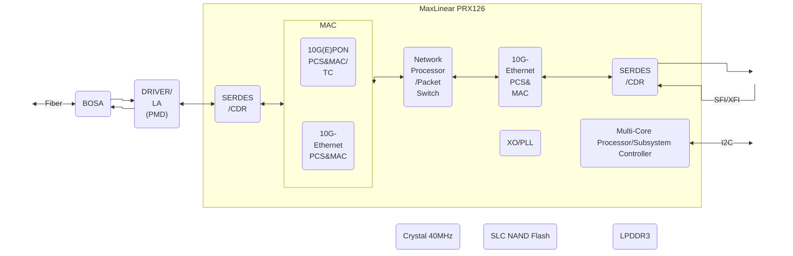

## Architecture

Block diagram of the MaxLinear PRX126 SoC ([product page](https://www.maxlinear.com/product/access/fiber-access/socs-for-optical-networking-units-onu/prx126)), a single-core MIPS interAptiv (34Kc family) running at 400 MHz, the successor of the Lantiq/Intel Falcon. Unlike the [Lantiq Falcon](/ont-nokia-g-010s-p#architecture), the laser driver / limiting amplifier (PMD) is an external chip between the BOSA and the SoC.

Diagram adapted from [pon.wiki](https://pon.wiki/xgs-pon/ont/bfw-solutions/was-110/#architecture) ([CC BY-NC-SA 4.0](https://creativecommons.org/licenses/by-nc-sa/4.0/)).
