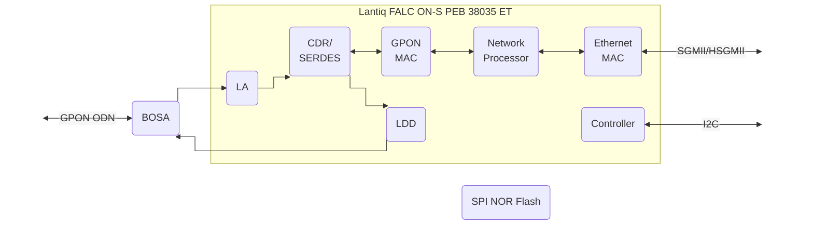

## Architecture

Block diagram of the Lantiq FALC ON-S PEB 38035 ET (PEB98035) SoC used by the Source Photonics SPS-34-24T-HP-TDFO and its rebrands (Nokia / Alcatel-Lucent G-010S-P, Huawei MA5671A, FS.com GPON-ONU-34-20BI). The laser driver (LDD) and the limiting amplifier (LA) are integrated in the SoC, so the BOSA is connected directly to it.

Diagram adapted from [pon.wiki: Source Photonics SPS-34-24T-HP-TDFO](https://pon.wiki/gpon/ont/source-photonics/sps-34-24t-hp-tdfo/#architecture) ([CC BY-NC-SA 4.0](https://creativecommons.org/licenses/by-nc-sa/4.0/)).
