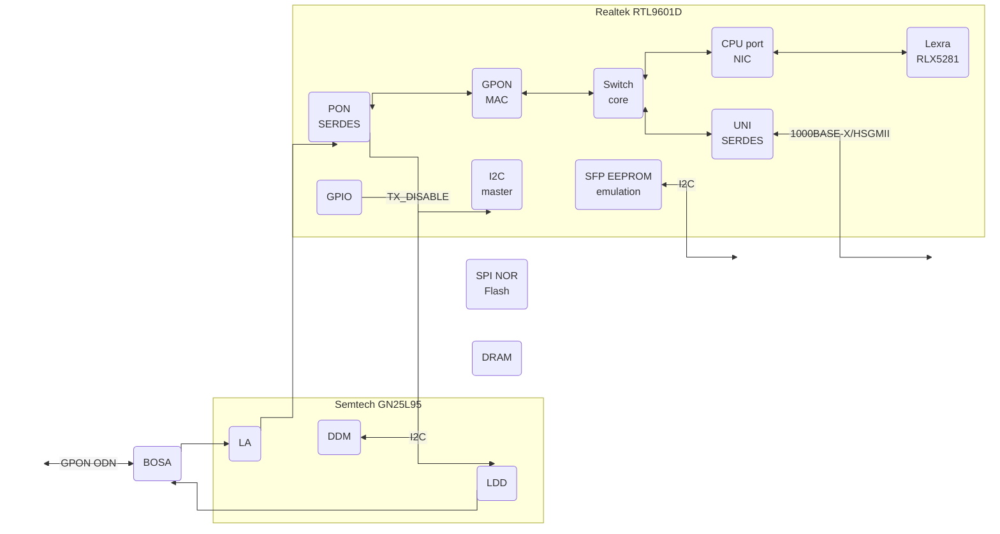

## Architecture

Block diagram of the Realtek RTL9601D (die RTL9602C, Lexra RLX5281 CPU) used by the ODI DFP-34X-2C2 / DFP-34G-2C2 and its rebrands. Unlike the Lantiq FALC ON, the laser driver (LDD) and the limiting amplifier (LA) are not integrated in the SoC: they are in an external Semtech GN25L95 combo chip, which also provides the SFF-8472 diagnostics (A0h/A2h) and is controlled by the SoC through its second I2C port. The module TX_DISABLE line is driven by the SoC GPIO 13.

The SFP EEPROM emulation is wired to the SFP edge only on some board revisions (e.g. DFP-34X-2C2 v08 / HSGQ XPON); on the others the host reads a separate fixed EEPROM with no diagnostics.

Diagram based on the hardware notes of [odi-oss](https://github.com/AndreZiviani/odi-oss) (`docs/HACKING.md`, `docs/KERNEL.md`, `docs/kb/`) and on the [Semtech GN25L95](https://www.semtech.com/products/signal-integrity/laser-drivers-transceivers/gn25l95) product page; layout adapted from [pon.wiki: Source Photonics SPS-34-24T-HP-TDFO](https://pon.wiki/gpon/ont/source-photonics/sps-34-24t-hp-tdfo/#architecture) ([CC BY-NC-SA 4.0](https://creativecommons.org/licenses/by-nc-sa/4.0/)).
