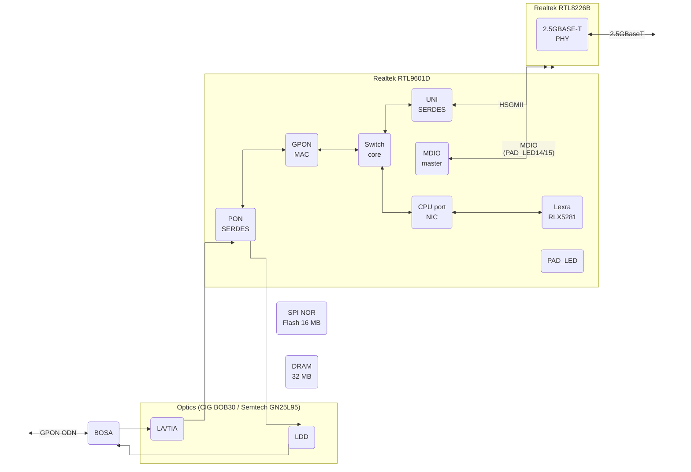

## Architecture

Block diagram of the CIG G-97CP (ZTE F6005, Nokia G-010G-T) box ONT. The SoC is a Realtek RTL9601D (die RTL9602C, Lexra RLX5281 CPU), the same die used in the GPON SFP sticks, but here it drives a 2.5GBaseT copper port through an external Realtek PHY instead of a direct HSGMII SFP edge. The laser driver (LDD) and the limiting amplifier (LA) are not integrated in the SoC: on the ZTE F6005 they are in an external CIG BOB30 BOSA module (driver M02099), controlled by the SoC through a dedicated interface; on the Nokia G-010G-T they are in an external Semtech GN25L95 combo chip, as in the SFP sticks. The four LEDs are on dedicated PAD_LED pads of the SoC: POWER and LAN are hardware-controlled (always on / PHY link), PON (LED index 1, `operation` type, green) and LOS (LED index 2, alarm-driven, red) are software-controlled.

The Nokia G-010G-T uses an RTL8221B PHY instead of the RTL8226B; the rest of the architecture is the same. The MDIO bus to the PHY is active on PAD_LED14 and PAD_LED15, which are therefore not available for LED functions.
